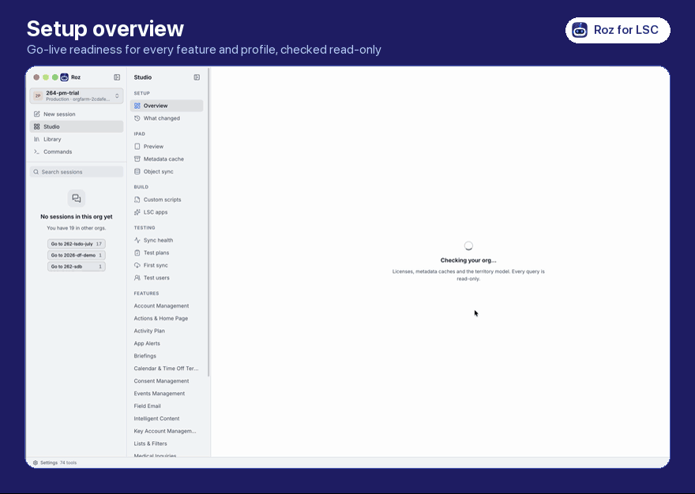
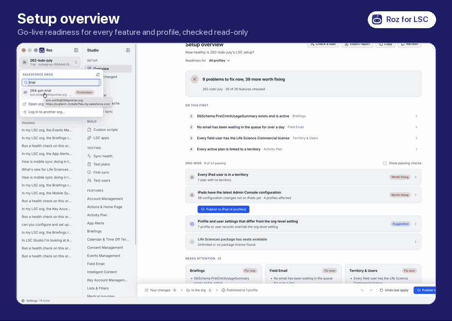
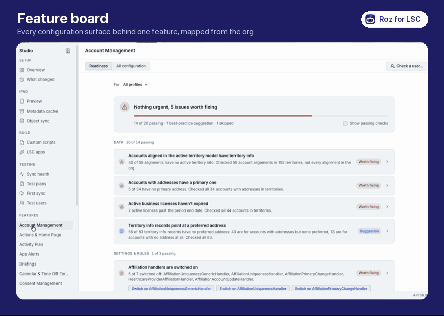
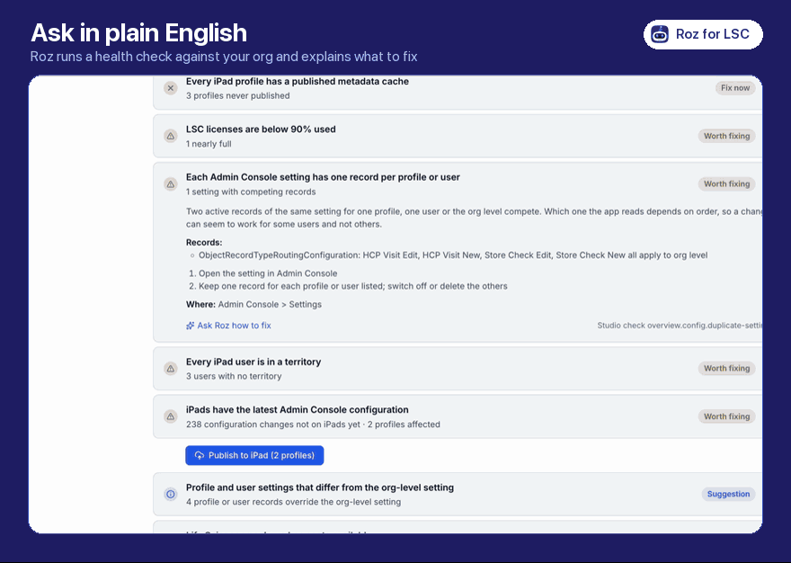
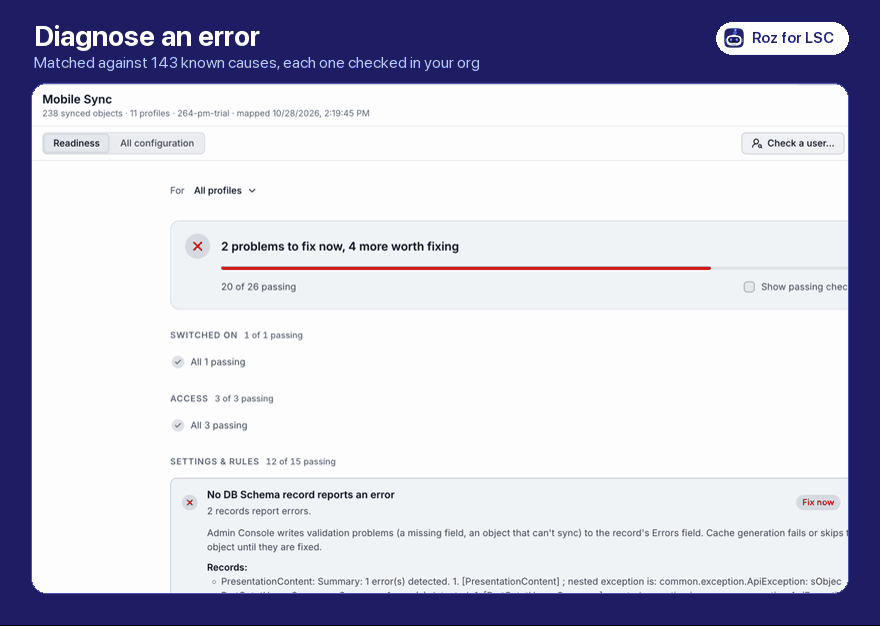
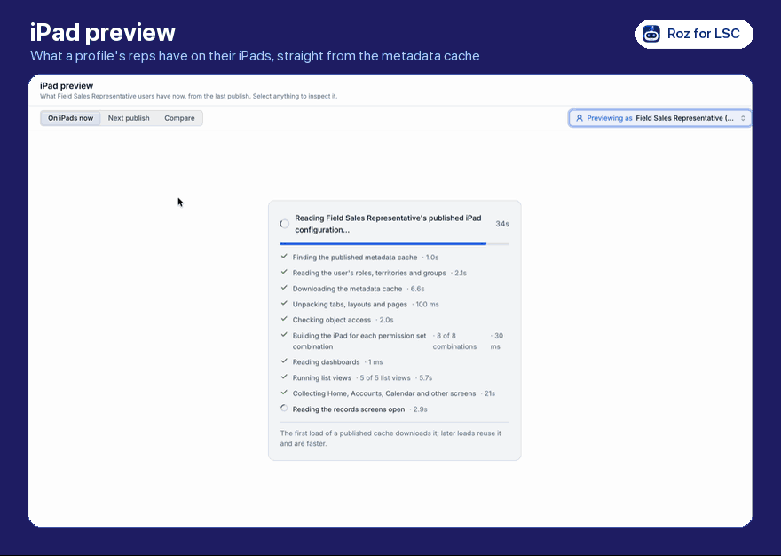
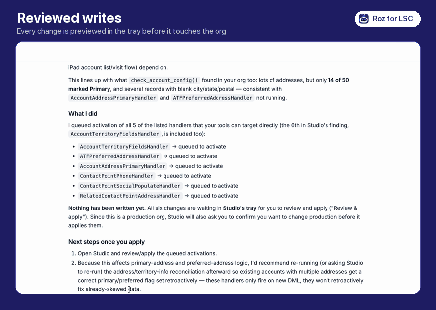
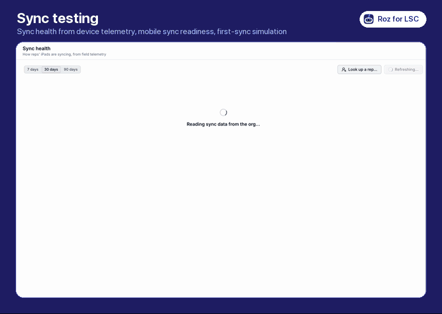
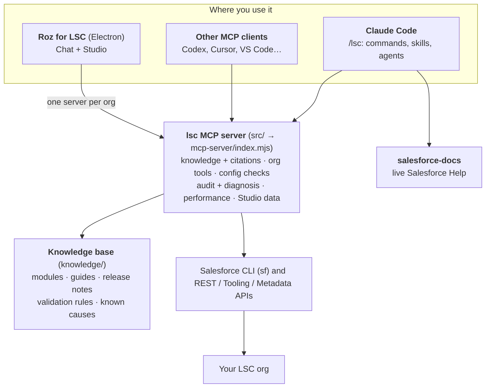

# Claude for Life Sciences Cloud (LSC)

[](https://github.com/SalesforceLabs/lsc-for-claude/releases)
[](https://github.com/SalesforceLabs/lsc-for-claude/actions/workflows/ci.yml)
[](https://github.com/SalesforceLabs/lsc-for-claude/actions/workflows/build-app.yml)
[](https://github.com/SalesforceLabs/lsc-for-claude/actions/workflows/release.yml)

LSC knowledge, Salesforce org tools and implementation guidance for Life Sciences Cloud for Customer Engagement (LSC4CE), for consultants, admins and developers.

## Two ways to use it

This repo ships one knowledge base and one set of org tools, packaged two ways. Use whichever fits how you work, or both.

| | **Claude Code plugin + MCP server** (terminal) | **Roz for LSC** (desktop app) |
|---|---|---|
| What it is | A [Claude Code](https://claude.ai/code) plugin: `/lsc:` commands, auto-invoked skills, agents and the `lsc` MCP server. The MCP server also works in Codex, Cursor and other MCP clients. | A Mac app (Electron) with chat plus **Studio**, a visual workspace for an LSC org: readiness checks, an iPad preview, builders and sync testing. |
| Best for | People who already live in Claude Code or another AI coding tool, scripting, working beside a source project | Admins and consultants who want a dedicated window, a picture of what reps see on the iPad, and reviewed changes |
| Model | Whatever your Claude Code (or other client) uses | Your choice: Salesforce's AI Model Gateway through Claude Code's settings, an Anthropic key, a company gateway, OpenAI, or an OpenAI-compatible endpoint |
| Writes to the org | The tools run when the model calls them (Claude Code asks for permission as usual) | Every write is reviewed: queued in Studio's tray or approved with **Allow** / **Deny** in chat |
| Install | `/plugin marketplace add SalesforceLabs/lsc-for-claude` | Download the `.dmg` from [Releases](https://github.com/SalesforceLabs/lsc-for-claude/releases); it updates itself |

Both talk to your org through the [Salesforce CLI](https://developer.salesforce.com/tools/salesforcecli) (`sf`) and your existing `sf org login`. Neither needs anything installed in the org.

<p align="center">
  
</p>

<p align="center"><sub><b>Roz for LSC</b>: go-live readiness, a live iPad preview, reviewed writes and sync testing, all read from your org</sub></p>

## What it can do

In both the plugin and the app:

- **Answer LSC questions** across 40+ modules with correct object names and citations to the source docs, plus live search of official Salesforce Help
- **Work with your org**: SOQL, describe, CRUD, Tooling API, metadata deploy/retrieve, anonymous Apex, bulk loads
- **Configure the Admin Console**: Application Settings, DB Schema, trigger handlers, Quick and Custom Actions, navigation tabs
- **Check configuration**: per-module config checks, a health check, and an audit of about 160 validation rules
- **Diagnose errors**: paste an error or describe a symptom and it's matched against 143 known causes from real misconfiguration cases, then checked in your org
- **Check a rep**: why a given user can't see or do something, traced through license, permissions, territory, sync and metadata cache
- **Mobile**: validate sync settings, generate the mobile metadata cache, predict a rep's sync volume, simulate a first sync, assess performance against NFR targets
- **Intelligent Content**: upload presentations (PPTX, PDF, HTML ZIP), distribute them to territories, tag topics and products
- **Move configuration**: export, diff two orgs, and import selectively (create and update only, never delete)

Only in the desktop app, through **Studio**:

- **Setup**: an org overview with go-live readiness per feature and per profile, a board of every configuration surface for each feature, and **What changed** (snapshots and recent changes)
- **iPad**: a preview of what a profile's reps have on their iPads now (read from the published metadata cache), what they'll get after the next publish, and the two side by side. Layouts, record headers, Lightning pages, list views and the tab bar can be edited right in the preview
- **Build**: a custom script editor with a test runner, an LSC app builder (describe an iPad app, Roz writes the LWC and runs it live before deploy), and Intelligent Content presentations, including draft pages
- **Testing**: org-wide sync health from device telemetry, test plans against NFR targets with a sign-off report, first-sync simulation as a real test user, and test-user logins
- **Release bar**: every change shows where it is: **Your changes** (queued), **In the org**, or **On iPads** (published). Changes are previewed before apply, can be undone, and can be saved as sfdx source files

### See it in action

<table>
  <tr>
    <td width="50%" valign="top">
      <a href="docs/media/roz/overview.gif"></a>
      <p align="center"><b>Setup overview</b><br><sub>Go-live readiness for every feature and profile, checked read-only</sub></p>
    </td>
    <td width="50%" valign="top">
      <a href="docs/media/roz/features.gif"></a>
      <p align="center"><b>Feature board</b><br><sub>Every configuration surface behind one feature, mapped from the org</sub></p>
    </td>
  </tr>
  <tr>
    <td width="50%" valign="top">
      <a href="docs/media/roz/health-check.gif"></a>
      <p align="center"><b>Ask in plain English</b><br><sub>Roz runs a health check against your org and explains what to fix</sub></p>
    </td>
    <td width="50%" valign="top">
      <a href="docs/media/roz/diagnose.gif"></a>
      <p align="center"><b>Diagnose an error</b><br><sub>Matched against 143 known causes, each one checked in your org</sub></p>
    </td>
  </tr>
  <tr>
    <td width="50%" valign="top">
      <a href="docs/media/roz/ipad.gif"></a>
      <p align="center"><b>iPad preview</b><br><sub>What a profile's reps have on their iPads, straight from the metadata cache</sub></p>
    </td>
    <td width="50%" valign="top">
      <a href="docs/media/roz/review.gif"></a>
      <p align="center"><b>Reviewed writes</b><br><sub>Every change is previewed in the tray before it touches the org</sub></p>
    </td>
  </tr>
  <tr>
    <td colspan="2" valign="top" align="center">
      <a href="docs/media/roz/testing.gif"></a>
      <p align="center"><b>Sync testing</b><br><sub>Sync health from device telemetry, mobile sync readiness, first-sync simulation</sub></p>
    </td>
  </tr>
</table>

---

## Roz for LSC (desktop app)

### Install

Download `Roz-for-LSC-<version>-arm64.dmg` from the latest [Release](https://github.com/SalesforceLabs/lsc-for-claude/releases), open it and drag **Roz for LSC** to Applications. Release builds are signed and notarized, so they open with no prompt.

The app updates itself from GitHub Releases: it checks after launch and every 4 hours, downloads in the background, and installs when you quit. When an update is ready the status bar shows **Restart to update**. Settings → **Updates** shows the version and has **Check for updates**. An app run straight from the disk image doesn't update, so copy it to Applications first.

Prebuilt installers are for Apple silicon Macs only. On an Intel Mac, Windows or Linux, [build it from source](#build-the-app-from-source).

### Connect to a model

On first launch the app asks how to reach a model. Each option is tested (list models plus one small message) before it's saved:

| Connection | Use it when |
|---|---|
| **Salesforce AI Model Gateway (Claude Code settings)** | You're a Salesforce employee with Claude Code set up for the gateway. The app reads the token helper and headers from `~/.claude/settings.json` when it connects. |
| **Anthropic API key** | You have a personal key from [console.anthropic.com](https://console.anthropic.com/settings/keys) |
| **Claude through a company gateway** | Your company serves `/v1/messages` at its own URL |
| **OpenAI API key** | You use OpenAI directly |
| **OpenAI-compatible endpoint** | Azure OpenAI, LiteLLM, Ollama, or a gateway serving `/chat/completions` |

OpenAI-style connections are best effort; the prompts were written and tested with Claude. Keys and tokens are kept in the macOS keychain, never in the settings file, and only sent over https (http is allowed for localhost). If nothing is saved, the app tries Claude Code's gateway settings, then `ANTHROPIC_API_KEY`.

### Connect an org

The app uses your Salesforce CLI logins. A first-run tour walks you through it: install the `sf` CLI if it's missing, log in (`sf org login web`, or **Log in to production…** / **Log in to a sandbox…** in the app), and pick an org. The tour can be reopened from the status bar's **Help** menu.

The selected org is your workspace: Studio, sessions and the Library follow it. Each chat session stays bound to the org it was started in, so you can keep a session running against one org while working in another. The org switcher lists connections where you hold the LSC admin permission set; others are folded under "Other connections". Production orgs are marked, and Roz confirms before writing to one.

### Reviewed writes

Chat never writes to the org unreviewed. When Studio can express a change itself (Admin Console fields, DB Schema, trigger handlers, permission sets), it's queued in Studio's tray, where you preview it, apply it and can undo it. Anything else asks for **Allow** or **Deny** in the chat before it runs.

### Build the app from source

You need Node.js 18+ and npm. From Claude Code with the plugin loaded:

```
/lsc:launch-app
```

or from a clone of this repo:

```bash
bash scripts/launch-electron-app.sh   # builds what's missing, then opens the app
npm run electron:dev                  # development, with reload on save
```

The first run installs dependencies, builds the MCP server and the Electron bundles and rebuilds the SQLite native module; later runs just relaunch. `electron:dev` reloads the renderer with Vite HMR, respawns the MCP server when `src/` changes, and restarts the app when the main process changes. `npm run electron:pack` produces installers for the platform you're on.

Builds from the **Build Desktop App** workflow (Actions → run → Artifacts) are unsigned, so macOS blocks them on first open. Right-click the app and choose **Open**, or run `xattr -dr com.apple.quarantine "/Applications/Roz for LSC.app"`. Unsigned builds don't update themselves.

### Troubleshooting the app

- **Window never appears, or a native module error:** the build log is at `$TMPDIR/lsc-assistant.log`. The usual fix is `npx @electron/rebuild -f -w better-sqlite3`.
- **Rebuild everything:** `LSC_FORCE_BUILD=1 bash scripts/launch-electron-app.sh`.
- **No orgs listed:** run `sf org list` in a terminal. If that fails, the app can't see the CLI either.

---

## Claude Code plugin (CLI and MCP server)

<p align="center">
  
</p>

<p align="center"><sub><code>/lsc:export-config</code> in Claude Code: snapshot org configuration and generate a browsable HTML report</sub></p>

### Prerequisites

- [Claude Code](https://claude.ai/code) 1.0.33+
- Node.js 18+
- The Salesforce CLI and an LSC org, for the org tools (the plugin offers to install the CLI)

### Install

**From the marketplace (recommended).** In Claude Code:

```
/plugin marketplace add SalesforceLabs/lsc-for-claude
/plugin install lsc@lsc
```

No `npm install` or build step: the MCP server ships prebuilt in `mcp-server/index.mjs`.

**From a clone (for development):**

```bash
git clone https://github.com/SalesforceLabs/lsc-for-claude.git
cd lsc-for-claude
npm install
npm run build
claude --plugin-dir .
```

### First-time setup

```
/lsc:setup-plugin
```

It checks for the Salesforce CLI (and offers to install it), checks your logins (`sf org login web --alias my-lsc-org` if you have none), and picks the org. With one org logged in it's used automatically; with several, Claude asks once. `/lsc:getting-started` gives a guided tour of what you can do.

### MCP servers

The plugin declares two MCP servers in [`.mcp.json`](.mcp.json):

| Server | Transport | Purpose |
|--------|-----------|---------|
| `lsc` | local (`node mcp-server/index.mjs`) | The plugin's own tools: knowledge base, org and Tooling operations, config checks, audit and diagnosis, performance, config import/export |
| `salesforce-docs` | remote (HTTP) | Live search of official Salesforce Help, used by the `lsc-docs-researcher` agent |

Claude Code asks you to approve `salesforce-docs` the first time. If you dismissed that prompt, the `lsc-docs-researcher` agent fails with a "zero tools" error. Run `/mcp`, enable or reconnect `salesforce-docs`, and restart the session if needed. It needs no key; if it still won't connect, check that `https://salesforce-docs-76258744c9d7.herokuapp.com/api/mcp` is reachable from your network.

### Use the MCP server with Codex and other clients

The `lsc` server is a standard [MCP](https://modelcontextprotocol.io/) server over stdio, so any client that can start a local MCP server can use it: OpenAI Codex CLI, Cursor, VS Code agent mode, Windsurf, Cline, Gemini CLI and others. Clone the repo (no build needed), install the Salesforce CLI and log in with `sf org login web`.

**Codex CLI:**

```bash
codex mcp add lsc -- node /path/to/lsc-for-claude/mcp-server/index.mjs
```

Then raise the tool timeout in `~/.codex/config.toml`. Deploys, health checks and performance runs on a large org can take several minutes:

```toml
[mcp_servers.lsc]
command = "node"
args = ["/path/to/lsc-for-claude/mcp-server/index.mjs"]
tool_timeout_sec = 600
```

If your company manages Codex with an approved list of MCP servers, `lsc` won't load until an admin adds it.

**Other clients** take the same command and arguments, for example Cursor's `.cursor/mcp.json`:

```json
{
  "mcpServers": {
    "lsc": {
      "command": "node",
      "args": ["/path/to/lsc-for-claude/mcp-server/index.mjs"]
    }
  }
}
```

Outside Claude Code you get every tool, the resources and the prompts. The server sends its usage rules when the client connects (which tools to use for Admin Console and DB Schema records, correct object names, how to pick an org), and clients that support MCP server instructions pass them to the model. The `/lsc:` commands, skills and agents are Claude Code features, so you don't get those. The tools were written and tested with Claude; other models may need more direction.

### Commands

| Command | Description |
|---------|-------------|
| `/lsc:setup-plugin` | Check plugin status and connect to Salesforce |
| `/lsc:getting-started` | Guided onboarding: check setup and see what you can do |
| `/lsc:status` | Dashboard of the connected org |
| `/lsc:open-org` | Open the org in the browser |
| `/lsc:soql-query <soql>` | Run a SOQL query |
| `/lsc:describe <object>` | Describe an object's fields |
| `/lsc:help <topic>` | Search the LSC knowledge base |
| `/lsc:docs` | Browse documentation by category |
| `/lsc:release-notes` | LSC release notes by Salesforce release |
| `/lsc:health-check` | Full org health check |
| `/lsc:audit [group]` | Audit configuration against the validation rules |
| `/lsc:validate-mobile` | Validate mobile app configuration before rollout |
| `/lsc:generate-metadata-cache` | Generate the mobile metadata cache |
| `/lsc:perf-assessment` | Assess mobile sync against an NFR profile (pass / warn / fail) |
| `/lsc:configure-accounts` | Configure and check account management |
| `/lsc:configure-activity-plan` | Configure and check activity plans |
| `/lsc:configure-briefings` | Configure and check Briefings (Daily Podcasts) |
| `/lsc:configure-custom-scripts` | Configure and check custom scripts |
| `/lsc:configure-home-page` | Configure and check the home page |
| `/lsc:configure-quick-actions` | Configure quick and custom actions |
| `/lsc:configure-samples` | Configure and check sample management |
| `/lsc:configure-territory` | Configure and check territory alignment |
| `/lsc:configure-users` | Configure and check user management |
| `/lsc:configure-visits` | Configure and check visit management |
| `/lsc:diagnose-briefings` | Find out why Briefings isn't working |
| `/lsc:diff-orgs` | Compare configuration between two orgs |
| `/lsc:export-config` | Export org configuration as JSON |
| `/lsc:import-config` | Import configuration from an export (create and update only) |
| `/lsc:launch-app` | Build (first run) and launch the Roz for LSC desktop app |

### Skills

Claude picks the right skill from what you ask. Skills are short routing guides that point Claude at the MCP tools, so answers carry citations instead of knowledge baked into the prompt. There are 38:

| Area | Skills |
|------|--------|
| Implementation | `lsc-implementation`, `lsc-implementation-review` (flags known-bad design decisions before go-live), `lsc-troubleshoot`, `lsc-health-check`, `lsc-data-model`, `salesforce-query` |
| Accounts and territories | `lsc-account-management`, `lsc-territory-alignment`, `lsc-lists-filters`, `lsc-user-management` |
| Field activity | `lsc-visit-management`, `lsc-sample-management`, `lsc-activity-plan`, `lsc-calendar-tot-routine`, `lsc-key-account-management`, `lsc-events-management`, `lsc-provider-engagement-compliance` |
| Content and engagement | `lsc-intelligent-content`, `lsc-field-email`, `lsc-consent-management`, `lsc-surveys`, `lsc-product-management`, `lsc-app-alerts`, `lsc-next-best`, `lsc-briefings`, `lsc-agentforce` |
| Mobile | `lsc-mobile-validation`, `lsc-mobile-app-settings`, `lsc-db-schema`, `lsc-home-page-configuration`, `lsc-quick-actions-configuration`, `lsc-custom-scripts`, `lsc-performance-validation` |
| Data and integration | `lsc-data-migration`, `lsc-config-migration`, `lsc-demo-data-loading`, `lsc-integration-patterns`, `lsc-reporting-analytics` |

### Agents

- **lsc-consultant**: senior implementation consultant for complex projects
- **lsc-admin**: day-to-day configuration, troubleshooting and maintenance
- **lsc-developer**: Apex, LWC, OmniStudio (web only) and integrations
- **lsc-docs-researcher**: searches live official Salesforce Help for setup and admin steps

---

## Examples

These work the same in Claude Code and in the app's chat.

**Ask how to set something up**

```
How do I set up Visit Management with product detailing and signature capture on the iPad?
```

**Run a wizard**

```
/lsc:configure-visits
```

It checks record types, detailing, compliance statements, trigger handlers and the mobile cache, then lists what needs attention and offers to fix it.

**Diagnose an error**

```
My reps see "Device sync transaction record was not found" when they sync
```

The error is matched against the known causes, each one is checked in your org, and you get the causes found and the records to fix.

**Check one rep**

```
Why can't Carmen Diaz see the Samples tab on her iPad?
```

**Change mobile sync**

```
Add Product2 to mobile sync for the Medical Sales Representative profile, active products only
```

In the app this is queued in Studio's tray for review; in Claude Code it runs after you approve the tool call. Either way, publish the metadata cache afterwards so reps get it.

**Distribute content**

```
Upload ~/Q1_CardioPresentation.pptx and distribute it to the Northeast territory and below
```

## Configuration audit

LSC setup is easy to get wrong, so the plugin includes about 160 validation rules in 22 rule files (`knowledge/validation-rules/`). Run them all with `/lsc:audit`, or one group:

| Group | When to use |
|-------|-------------|
| `mobile-login-check` | Users can't log in to the mobile app |
| `pre-deployment` | Before rolling mobile out to users |
| `sync-troubleshooting` | Mobile sync isn't working |
| `full-mobile-audit` | Full mobile check |
| `visit-config-check`, `sample-config-check`, `account-config-check`, `activity-plan-config-check`, `territory-config-check` | Core module issues |
| `kam-config-check`, `field-email-config-check`, `intelligent-content-config-check`, `next-best-config-check`, `consent-config-check`, `surveys-config-check`, `app-alerts-config-check`, `agentforce-config-check` | Other module issues |
| `home-page-check`, `quick-actions-check`, `custom-actions-check` | Home page and actions |

`/lsc:audit` with no arguments lists every group. In the app, the same rules drive Studio's Readiness views.

## Covered modules

Account Management, Visit Management, Sample Management, Activity Plan, Territory Alignment, User Management, Key Account Management, Next Best (NBC/NBA/NBM), Field Email, Intelligent Content, Calendar / Time Off Territory / Routines, Consent Management, Surveys, Product Management, App Alerts, Lists & Filters, Home Page, Quick Actions, Custom Scripts, Briefings, Events Management, Provider Engagement Compliance (EPPV/MID), Order Management, Medical Inquiries, Agentforce for LSC, Mobile App Settings, Mobile Metadata Cache, Starter Config, Segmentation, Workflow Management, Data Cloud, LSC Apps, Data Migration, Integration Patterns and Reporting & Analytics.

Release notes are included through Winter '27 (`/lsc:release-notes`), and official Salesforce Help is searched live through the `salesforce-docs` server rather than bundled.

Every knowledge tool answer ends with its source:

```
> 📖 **Source:** PM Enablement — Visit Management
> 🔗 **Link:** https://help.salesforce.com/s/articleView?id=sf.ls_engagement_execution.htm
> 📂 **File:** knowledge/modules/visit-management/admin-console-transcript.md
```

## Architecture



The desktop app runs its own model loop (`src-electron/engine/`) with the same skills and commands as the plugin, and starts one `lsc` MCP server per org connection. Studio calls the server's `studio_*` tools directly; those are hidden from the chat model, and the ones that write are only registered inside the app.

## Project structure

```
lsc-for-claude/
├── .claude-plugin/     # Plugin and marketplace manifests
├── .mcp.json           # MCP servers for Claude Code
├── commands/           # 29 /lsc: slash commands
├── skills/             # 38 skills
├── agents/             # 4 subagents
├── src/                # lsc MCP server (TypeScript)
│   ├── tools/          #   tool modules
│   ├── salesforce/     #   sf CLI wrapper, direct REST/Tooling/Metadata paths, API version
│   ├── validation/     #   YAML rule engine and diagnosis
│   ├── perf/           #   sync volume, telemetry, first-sync simulator
│   ├── studio/         #   data and changes behind the app's Studio
│   └── config/         #   config export, diff and import
├── mcp-server/         # Bundled server (committed build artifact)
├── src-electron/       # Desktop app main process: model connections, engine, org pool, updater
├── src-renderer/       # Desktop app UI (React)
├── knowledge/          # Knowledge base
│   ├── modules/        #   43 module directories
│   ├── guides/         #   admin, developer and mobile setup guides
│   ├── release-notes/
│   ├── troubleshooting/#   common issues, anti-patterns, known-causes.yaml
│   ├── validation-rules/
│   └── app-starters/   #   pinned starter apps for the app builder
├── test/               # Vitest unit and integration tests
├── scripts/            # build, launch, release, screenshots, doc processing
├── build/              # app icons and packaging hooks
└── docs/               # design notes, NFR profile example, media
```

## Development

```bash
npm install
npm run build          # compile the MCP server to dist/
npm run dev            # watch mode
npm test               # Vitest
npm run lint
npm run verify         # every CI check locally; run before pushing
npm run electron:dev   # desktop app with reload on save
```

`mcp-server/index.mjs` is a committed build artifact. After changing anything under `src/`, run `npm run bundle` and commit the result, or CI's bundle-sync check fails.

UI changes under `src-renderer/` follow the `roz-ui` skill (`.claude/skills/roz-ui/SKILL.md`). Look at a change with `node scripts/ui-shots.mjs tour` after `npm run electron:build`.

### Adding a module

1. Add markdown files to `knowledge/modules/<module-slug>/`
2. Add citation entries to `src/citation-map.ts` (`moduleCitationMap` for the module slug and one per file)
3. Add a skill at `skills/<skill-name>/SKILL.md` with `description` frontmatter that routes to `get_lsc_module_docs` and `search_lsc_knowledge` rather than repeating the docs
4. Run `npm test` to check citation coverage and skill structure

### Cutting a release

The plugin and the desktop app share one version.

```bash
scripts/bump-version.sh 0.9.1     # bump the manifests, commit, tag v0.9.1
git push --follow-tags            # the Release workflow builds, signs and notarizes
scripts/publish-release.sh v0.9.1 # then publish it from your machine
```

The SalesforceLabs org has an IP allow list that GitHub's hosted runners aren't on, so the workflow can't create the GitHub Release itself. It uploads the signed installers as a run artifact, and `publish-release.sh` waits for the run, downloads them and creates the release (you need to be on an allowed network, with `gh` logged in as an account that can write to the repo). Every release must include `latest-mac.yml`, or installed apps won't see it.

## Resources

- [Salesforce LSC documentation](https://help.salesforce.com/s/articleView?id=sf.health_life_sciences.htm)
- [Claude Code plugins](https://code.claude.com/docs/en/plugins)
- [MCP specification](https://modelcontextprotocol.io/)
- [Salesforce CLI](https://developer.salesforce.com/tools/salesforcecli)

## Acknowledgments

This project was originally created by **Joe Ferraro**, GM of Agentforce for Life Sciences. It exists thanks to his vision for bringing LSC implementation expertise directly into the hands of consultants, developers, and administrators. The community is grateful for that foundation and continues to build on it.

## License

MIT — see [LICENSE.txt](LICENSE.txt).
