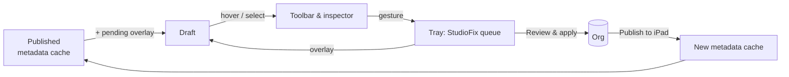

# iPad preview — Edit mode

Status: Phases 1–2, 3a–3d and 4a (undo/redo, multi-select, side by side) built; the rest of 4 designed, 2026-10-18. Branch `feat/ipad-edit-mode`.

## The problem

An admin looking at the iPad preview asks three questions about anything on screen:

1. **What is this?** Which piece of configuration put it here?
2. **Why do I see it?** Which profile, permission set, assignment or visibility rule makes it show up for this rep?
3. **How do I change it?** Move it, hide it, remove it, add something next to it, configure it.

Before edit mode, the "As published" preview, the accurate one, answered none of these: nothing in it could be clicked. The "After next publish" schematic could be clicked, but it didn't look like the app. Edit mode merges the two: the accurate picture, where you can select things and change them in place.

## Principles

- **The preview is the editor.** You change things where you see them. Setup boards stay the place for bulk and deep work; the preview links to them and doesn't duplicate them.
- **Nothing is written until you review it.** Every gesture queues a change in the existing tray. Review, apply, undo and Publish to iPad all work as they do today. Edit mode adds no new write path.
- **Honest about reach.** A Home page is shared by every profile it's assigned to. A layout applies to every record type that uses it. Each edit says who it affects before you make it.
- **Honest about capability.** If Studio can't write something, the preview still explains it and gives exact steps plus "Open in Setup". There are no dead clicks and no fake edits.
- **Calm.** No chrome until you ask for it. Hover reveals, click selects, and the toolbar shows only verbs that work on the thing you selected.

## The experience

### Entering

A segmented control above the device: **Published · Draft**. A pencil **Edit** button (`E`) sits beside it.

- **Published**: what reps have today, from the metadata cache.
- **Draft**: Published with every pending tray change laid on top. Turning Edit on switches to Draft automatically.

Draft replaces the "After next publish (estimate)" schematic: Draft is the estimate, drawn with the real renderer. The schematic was a third segment (**Schematic**) until Visit engagement sidebar editing moved into Draft; Phase 3a retired it.

### Hover and select

In Edit mode every block that comes from configuration gets a hairline outline on hover, with a small name tag at its top-left corner, e.g. `Home component · Next Best Customers`. Blocks include tab pills, Home components, record header fields, layout sections, fields, related lists, ••• actions, list views and the sync badge.

Clicking selects the block: a 2pt accent ring plus a **floating toolbar** anchored above it, like Keynote or Freeform. The toolbar shows only the verbs that apply to that block:

| Verb | Shown for |
|---|---|
| ↑ ↓ / drag handle | tabs, Home components, layout fields and sections, actions |
| Hide / Show | tabs, actions (IsActive); components with a visibility rule |
| Remove | Home components, layout fields and related lists, tabs |
| ＋ Add before / after | anything ordered |
| Configure… | component props, field required/read-only, action fields |
| ⓘ | opens the docked inspector at What / Why / How |

Keyboard shortcuts: `⌫` remove, `⌥↑/⌥↓` move, `⌘Z` / `⇧⌘Z` undo/redo the last tray change, `Esc` deselect, `Tab` next block.

### Direct manipulation

- **Drag to reorder.** Blocks lift with a soft shadow and slight scale. Siblings slide out of the way with spring easing. On drop the change is queued and the moved block pulses once in the "pending" purple. Within a region only; cross-region moves are refused, with a nudge animation.
- **Insertion points.** Between ordered siblings, hovering the gap shows a thin `＋` line. Clicking it opens a **library popover** of what can go there: Home components the template supports, layout fields that exist on the object but aren't on the layout (with "not synced to the device" warnings from DB Schema), tabs not yet on the bar, quick-action types. Search at the top; items the iPad can't render (OmniStudio, unsupported LWCs) are greyed out with the reason.
- **Removed items** stay in Draft as ghosts (translucent, struck label) until you apply, so you can undo them in place.

### The inspector: What / Why / How

Docked beside the device, three short sections:

- **What**: the type and its source, as a breadcrumb: `FlexiPage "LSC Home" › main region › 3rd of 6`, or `Layout "Account-HCP Layout" › Section "Details" › field Specialty__c`, or `Admin Console › UISchema › TAB_Accounts`.
- **Why you see it**: the audience chain for the current View as profile. Tab visible via profile assignment; component shown because `$Permission.X` is granted by PSG Y; field readable via FLS on permission set Z.
- **How to change it**: the verbs above as buttons, then the reach ("Affects 3 profiles: Rep, KAM, Manager"), then, for anything Studio can't write, numbered Setup steps with **Open in Setup**.

### Leaving and committing

The tray (already in Studio) fills as you work. The preview shows a quiet counter, `4 changes · Review`. Review opens the existing ReviewDialog, which already does before/after, guards, apply in order and undo all. Changes to Admin Console records or Metadata then offer **Publish to iPad** for the affected profiles. Until publish finishes, Draft keeps a banner: *Applied, not yet on iPads*.



## What can be edited

| Surface | Store | Studio today | Edit mode |
|---|---|---|---|
| Tab bar: order, hide, add, remove | UISchema `LifeSciConfigRecord` (TabOrder, IsActive) | `setConfigField`, `setActive`, `createConfigRecord` exist | Phase 2: drag, toggle, library. Overlay pending TabOrder |
| ••• actions: order, hide, add | QuickAction / CustomAction records (SortOrder, IsActive) | same as above | Phase 2 |
| DB Schema: is this object on the device | DbSchema records | exists | Phase 2: "Not synced" chip with **Add to iPad sync** |
| Home components: order, remove, add, props | FlexiPage (Metadata API) | none | Phase 3: new fix `editFlexiPage` |
| Record page tabs and components | FlexiPage | none | Phase 3: same fix kind |
| Layout fields, sections, related lists | Layout (Metadata API) | Visit related lists only | Phase 3: generalize `visit-layout.ts` into `editLayout` |
| Record header fields | CompactLayout | none | Phase 3: `editCompactLayout` |
| List views | ListView | none | Phase 4 (filters are a larger UI) |
| Visibility rules, record type assignment, FLS | various | none | Explain + Open in Setup only (for now) |

### Metadata edits

Phase 3 covers these surfaces; the full design is in **Phase 3 design** below.

## Foundation work (Phase 1): provenance

The published snapshot (`src/studio/published.ts`) currently drops the identities edit mode needs:

- Home and record page components have only `name`. Add `source: { page, region, index, identifier? }` (`componentInstance.identifier` when present, else region+index).
- Layout sections and fields have no index. Add `source: { layout, section, column, row }`.
- Tabs have `fullName` but no UISchema DeveloperName. Match `TabName` → `UISchema:<DevName>` with the live config read.
- Home ••• actions are read live but only keep `MasterLabel` and `ActionName`. Also keep `DeveloperName`.
- Each block gets an `EditTarget` = `{ itemId (map address), capability: "edit" | "explain", reach }`, built in one pure function so it's testable without a renderer.

Phase 1 delivers the hover/select layer and the What / Why / How inspector over **Published**, read-only. That already answers "how do I…" for everything, and it ships without any new write path.

## Phases

1. **Select & explain** *(built)*: hover/select/toolbar shell; What / Why / How inspector; Open in Setup with a deep link (`sfOrg:open` takes a path). *No writes.* Provenance was built only as far as the explain layer needs it: block keys use names and post-filter indices. Phase 3 adds the rest.
2. **Draft + Admin Console edits** *(built)*: Published · Draft · Schematic; pending overlay for TabOrder, SortOrder, IsActive, profile assignments and creates; move/hide/turn off for tabs and Home ••• actions with reach warnings; **Add to iPad sync** for objects the profile doesn't sync. Drag is deferred to 3d. The Schematic stayed until 3a, because it was still the only place to edit the Visit engagement sidebar.
3. **Metadata edits**, in four steps (see **Phase 3 design**):
   - 3a *(built)*: provenance, a metadata document layer, `editMetadata` for Layouts. Visit sidebar editing moved into Draft and the Schematic is retired: the preview is **Published · Draft**. Sections, fields and related lists move, hide and change behavior in place; **Add field…** and **Add related list…** pick from the object's describe (`available` / `availableRelated` on the live layout), and an added list whose child isn't synced offers **Add to iPad sync**.
   - 3b: Compact layouts (record header) *(built)*: header fields move left/right, remove/restore, and **Add field…** (a searchable picker); one diffed `editMetadata` change per compact layout (`metadata:CompactLayout:<fullName>`); warns at 7 or more fields; Add is refused at the Metadata API's 10-field limit.
   - 3c: Lightning pages *(built)*:
     - Home and record page components move up/down and can be removed or restored. Record tabs move left/right, can be removed or restored, and can become the default.
     - **Insert component…** is a search picker over `studio_component_catalog` and the components removed in Draft. Components that need Lightning App Builder are named in its description, not shown greyed: `SearchPicker` has no disabled options.
     - The inspector edits `mobileHeight`, a tab's `title` (warns over 25 characters) and `rowsToDisplay` / `maxRecordsToDisplay`.
     - Each page gets one diffed `editMetadata` change (`metadata:FlexiPage:<fullName>`, `flexipage-ops.ts`).
     - The reach is profile assignments plus app defaults. Managed pages are explain-only.
     - Not yet: a record page's single related lists are still selected as layout related lists, so they can't be moved or removed as page components.
   - 3d *(built)*: drag to reorder, insertion points, keyboard moves. In Draft, tabs, Home ••• actions, layout sections, fields, related lists and header fields drag with pointer events (`DragSpec` on `editAttrs` / `Mark`, `onDrop` on `EditSurface`): the block lifts, a purple line marks where it would land, and a drop pulses (or nudges when refused); Escape cancels. Siblings don't slide aside — the line stands in for that. Fields cross columns and sections; other drags stay in their list (sections of one layout, the tab bar, the Home menu, one header). A drop queues what the verbs would — `moveTabTo` / `moveActionTo` step the up/down verbs, `moveFieldTo` / `moveSectionTo` / `moveRelatedTo` and `moveCompactFieldTo` re-arrange and re-diff — and a drop back where it started queues nothing. ⌥↑/⌥↓ (⌥←/⌥→ in the tab bar and header) run the move verbs on the selection. A layout with no related lists shows a placeholder card in Draft that takes **Add related list…**. Not yet: empty columns as drop targets, auto-scroll while dragging, dragging across tab-bar pages.
4. **Polish & breadth**: list views, component props sheet, ⌘Z wired to the tray, multi-select, before/after split view, "Make a copy just for this profile".
   - 4a *(built)*: **Undo / redo** for the tray (`tray-history.ts`): every queue, removal, verb and Discard all is a step; ⌘Z / ⇧⌘Z (Ctrl on Windows and Linux) anywhere except text fields and while Review is open, plus Undo / Redo icon buttons in the tray whose tooltips say what they'd take back. The tray stays up, empty, while a step can be undone or redone; applying starts a new history. **Multi-select** (`multi-select.ts`): ⌘- or ⇧-click adds a block of the same kind in the same container (layout, compact layout, Lightning region, tab bar, ••• menu) or drops it again; every selected block is ringed and the toolbar names the group ("3 fields"). Only verbs every block has with the same label are offered (remove / restore, hide / show, turn off / on, required, read only, heading, discard); moves, columns and adds stay single-block. A group verb runs block by block, each against the tray the last one left, so layouts still end up as one diffed change per document. **Side by side** (the preview's third mode): Published and Draft at half size, sharing tab, record and scroll position; only the Draft side is selectable and opens sheets.
   - 4b component properties *(built)*: the inspector's **Properties** sheet for a selected Home or record page component (`PropertiesSheet.tsx`). Definitions come from `studio_component_props` (`src/studio/component-props.ts`): a custom LWC's `js-meta.xml` `targetConfigs` for `lightning__HomePage` / `lightning__RecordPage` (Tooling `LightningComponentResource`; `type`, `label`, `description`, `default`, `min`, `max`, `required`, a static `datasource` becomes a picklist; a managed bundle that hides its source falls back to untyped fields), or a curated table for the standard and LSC components the iPad draws (rich text, Recent items, related lists, dashboards, Activity plan by product, Agentforce welcome, tabs), each marked `used` / `unused` / `unknown` for the iPad against `PROP_KEEP` and the preview's own rules. Properties already on the page that no definition covers are listed as untyped text fields (facet pointers and list values are left out). Fields are typed (text, number with range, switch, picklist, text area), show the pending value and the org's with **Reset**, and check required / range / choice (`component-props.ts`; a tab's title still warns over 25 characters). Text and numbers queue on blur or Enter, switches and choices at once, so each edit is one undo step; an empty optional value takes the property off. Edits go through `propertyEdits` into the page's one diffed `setComponentProperty` change (the property is any `\w+` name now, values up to 1,000 characters; the server refuses list-valued properties and ones that point at a region), and Draft re-renders where the preview reads the property (`withProperties`: `mobileHeight` frame height, rich text, Agentforce chips, related-list rows, half-width Activity plan). Tests: `component-props.test.ts` (js-meta parsing, lookup, typed checks), `flexipage-draft.test.ts` and `flexipage-ops.test.ts` (round trip to the XML).

## Phase 3 design

Grounded in three surveys of the code on 2026-10-18: Studio's write path, the published snapshot, and how lifesciences-ios renders pages.

### What we start from

- **The cache is Metadata-shaped JSON.** `published.ts` reads `ui.flexiPages`, `ui.pageLayouts` and `ui.compactLayouts` from the metadata cache. They have the same structure as the Metadata API XML, so a position in the cache *can* be a position in the XML, if we keep it. Today we don't:
  - Indices are counted after filtering out unsupported components, hidden tabs, blank layout items, empty sections and Name in compact layouts, so one hidden neighbour shifts every key.
  - `componentInstance.identifier` is never read.
  - Facet regions are discarded, because tabsets arrive pre-nested.
  - Related-list targets carry a label, not the `relatedList` name.
- **The only metadata write is Visit layout related lists** (`visit-layout.ts`):
  - It runs `sf project retrieve` into a temp SFDX project, edits the XML with regexes, then runs `sf project deploy --source-dir`. Each step is a 5–30 s CLI call, and the temp dirs are never cleaned up.
  - There is no XML parser in the repo.
  - Stale guards compare values (`from` vs live), not hashes.
  - Undo is a computed inverse fix, not a saved copy.
  - Each related list is its own change and its own deploy.
- **Nothing tells production from sandbox on write**, and nothing checks whether a page is managed and can't be deployed.
- **The iPad (UIKit renderer, not the iPhone SwiftUI one) decides what Draft must show:**
  - It drops unsupported components *silently*. Only an empty Home page shows a message.
  - Only these template regions exist:

    | Template | Regions |
    |---|---|
    | recordHomeSingleColTemplateDesktop | header, main |
    | recordHomeTemplateDesktop | header, main, sidebar |
    | appHomeTemplateHeaderTwoColumnsLeftSidebar | header, sidebar, main |
    | defaultAppHomeTemplate | header, main |
    | defaultFlexiPage | main |
    | desktopTemplate | top |

    Other templates, and a page whose only region is main, fall back to defaultFlexiPage, so their header and sidebar components vanish.
  - The Lightning page's tabset decides the record tabs; the layout only fills the detail panel and the related lists.
  - Related lists whose child object isn't synced are skipped silently. Single related lists show 5 rows unless the list is dynamic or ADVGRID.
  - The record header is the record name plus the compact layout's fields in one scrolling row. There is no field limit; fields equal to the title, Account `Name` and unreadable fields are dropped.
  - A visibility rule with several criteria and no boolean filter probably hides its component.

### Addressing: names first, structural indices second

An edit has to point at one element of one document even if the org changed after the cache was built. Each block gets a `source` in the snapshot (bump `SNAPSHOT_VERSION`):

| Block | Document | Address |
|---|---|---|
| Lightning page component | `FlexiPage:<DevName>` | `{ region, facet?, index }`: XML region name (or the facet a tab points at) and the index *before* filtering, plus `expect: { componentName, identifier? }` |
| Record page tab | `FlexiPage:<DevName>` | the `flexipage:tab` item in the tabset's `tabs` facet, `{ facet, index, expect: { title } }` |
| Layout section | `Layout:<Obj-Name>` | `{ section: index }`, counting empty sections, `expect: { label }` (the raw XML label) |
| Layout field | `Layout:<Obj-Name>` | keyed by `field` (unique on a layout), with `{ section, column, row }` for moves |
| Related list | `Layout:<Obj-Name>` | keyed by `relatedList` name (`Contacts`, `Visit.ParentId`…) |
| Compact layout field | `CompactLayout:<Obj.Name>` | keyed by field API name |

Fields, related lists and compact-layout fields are addressed by name, so unrelated edits elsewhere in the document never invalidate them. Components and sections have no reliable name, so they use indices with an `expect` check.

**Live alignment.** When you select a block on a page, Studio retrieves that document once for the edit session (`studio_metadata_doc`, cached per org + document until apply) and checks the snapshot's addresses against it:
- **They match:** the block is editable.
- **They don't match** (someone changed the page in Setup since the last publish): the block stays explain-only, with *"This page changed in Setup since the last publish. Publish to iPad first, or edit it in Setup."* Draft never mixes an unpublished org version with the cache.

### Document layer (server)

`src/studio/metadata-doc.ts` generalizes `visit-layout.ts`:

- **Retrieve and deploy.** Retrieve by `type:fullName`, and find the file by type rather than "first file in the folder":
  - `layouts/X.layout-meta.xml`
  - `flexipages/X.flexipage-meta.xml`
  - `objects/<Obj>/compactLayouts/X.compactLayout-meta.xml`

  Deploy the one file. Temp folders are removed after each call.
- **Parse with `fast-xml-parser`** (new dependency) in `preserveOrder` mode, so a round-trip keeps element order and unknown elements. Serialize with the same indentation Salesforce uses, so the review diff shows only what changed. Ops work on the parsed tree; they replace the regexes.
- **Can it be deployed?** The preview reads `NamespacePrefix` / `ManageableState` (FlexiPage via SOQL, Layout and CompactLayout via Tooling). A managed, installed page is blocked with steps to clone it in Lightning App Builder.
- **Reach**, computed at preview time and also shown in the inspector:
  - Layouts: Tooling `ProfileLayout` (profile × record type → layout).
  - Compact layouts: the record type assignments in the object's metadata.
  - Lightning pages: their activations in `CustomApplication` profile overrides plus object action overrides, retrieved with the document. When that can't be read, Studio says *"may be used by other profiles"* rather than guessing.

### One fix kind

```ts
type DocRef =
  | { type: "Layout"; fullName: string }        // "Account-HCP Layout" (with ns__ when namespaced)
  | { type: "CompactLayout"; fullName: string } // "Account.LSC_HCP"
  | { type: "FlexiPage"; fullName: string };

type MetadataOp =
  | { op: "move"; from: Address; to: Address }
  | { op: "remove"; at: Address; removed?: string }     // removed: the element's XML, filled in at apply time for undo
  | { op: "insert"; at: Address; element: InsertSpec }  // InsertSpec: field / relatedList / component from the catalog
  | { op: "set"; at: Address; name: string; from: string | null; to: string | null };

{ kind: "editMetadata"; doc: DocRef; label: string; ops: MetadataOp[] }
```

Why one kind rather than three: preview, apply, undo, guards, Zod schema, tray key and review rendering are the same for every document type. Only address resolution and the catalog differ per type, and they sit behind `metadata-doc.ts`.

- **Stale guard:** per op, as Studio does today. Every address carries `expect`, and `set` carries `from`. The preview resolves each op against the live document:
  - **The item is missing or different:** *"changed since the map was loaded"*.
  - **Every op is already true:** *"Already applied. Refresh the map."*

  A whole-document hash would refuse whenever anyone touched anything else on the page.
- **Undo** is the inverse op list, in reverse order (move ↔ move, insert ↔ remove, set ↔ set), so it stays small enough for IPC and the Zod schema. The only snapshot it needs is the removed element's XML, captured at apply time.
- **Tray merging:** the change key is `metadata:<type>:<fullName>`. `queueChange` appends ops to the existing fix, so one page means one retrieve and one deploy. Inverse ops cancel (move A down then up, remove then show), and an empty fix is dropped. The existing Visit related-list fix becomes `editMetadata` on its layout; its Inspector board entry queues the same kind.
- **Review:** the before/after shows the ops in plain words (*"Move field Specialty to section Details, column 1, row 3"*) plus the XML diff, collapsed. The warnings:
  - the reach (every profile and record type that uses the document);
  - the iOS rules each op trips (next section);
  - `PUBLISH_WARNING`.

### Ops per surface

| Surface | Ops in Phase 3 | Notes from iOS |
|---|---|---|
| **Layout** (3a) | move/remove field; move field across columns and sections; set field behavior Required / Edit / Readonly; move/remove section; toggle the section heading (`detailHeading`); move/remove/add related list (replaces `visit-layout.ts`); add a field from the object's fields not on the layout | Unreadable fields are dropped; System fields hidden; OwnerId, RecordTypeId and auto-number fields stay locked whatever the behavior; section style and collapsing are ignored; related lists need the child synced, so add offers **Add to iPad sync** |
| **Compact layout** (3b) | move/remove/add field | The title is always the record name; a field equal to the title or Account `Name` is dropped; no field limit, but fields after the first 6 or so scroll off, so warn at 7 or more |
| **Lightning page** (3c) | move/remove a component within its region or facet; move/remove a record tab; insert from the library; `set` on a short list of properties: `mobileHeight` for inline LWCs, a tab's `active` flag and `title`, `maxRecordsToDisplay` / `rowsToDisplay` | Moves across regions are refused (as already designed). Insert only into regions the template has on iPad. Tab titles over 25 characters are cut. A component with a multi-criteria rule and no boolean filter gets a warning |

**Library** (3c, `src/studio/component-catalog.ts`). A catalog of components the iPad renders, built from `published.ts`'s support rules plus full `namespace:name` values (today's suffix rules aren't full names). Each entry has: label, where it may go (Home / record, regions), required properties, and whether Studio can fill them in.
- Phase 3 offers only components Studio can insert completely:
  - anything you removed in this session;
  - `flexipage:recentItems`;
  - the org's `lscMobileInline_*` LWCs (prefilled `mobileHeight` 400);
  - related lists of synced child objects.
- Components that need a report, dashboard or list view are listed greyed out with *"Add in Lightning App Builder"* and Open in Setup, until the props sheet in Phase 4.

### Draft for metadata

The renderer applies queued ops to the snapshot (`src-renderer/components/studio/draft-metadata.ts`). It works on the same addresses, mirroring the server's op application on XML. A shared fixture test runs both on the same cases and compares the results.

- **Moved** blocks pulse purple once; **removed** ones are ghosts; **inserted** ones are drawn with the real renderer.
- Where the iPad would drop something silently, Draft shows it instead:
  - an inserted component the template's iPad regions don't have, or the iPad doesn't support: a dashed ghost, *"Won't show on iPad: …"*;
  - a related list for an unsynced child: the same ghost, with **Add to iPad sync**;
  - a field the rep can't read: a struck-through label with the field-security reason.
- Draft stays honest about what isn't simulated: it never fetches new data, so an inserted related list shows its columns with *"Records appear after sync"*.

### Production

`Organization.IsSandbox` is read once per org, and the Studio header shows a **Production** pill. For metadata changes on production, the review dialog's Apply button reads *"Apply to production"*. It is enabled only after a checkbox: *"I understand these pages change for reps as soon as they next sync after publish."* Admin Console changes keep today's flow.

### Risks

- **Retrieve/deploy latency** (5–30 s per document through the CLI). Mitigations:
  - retrieve the document when the block is selected, not at apply;
  - one deploy per document;
  - the review dialog shows a progress line per document.

  If this is still slow, a later step can switch to the Metadata API over REST (`deployRequest`) without changing the fix shape.
- **Not atomic:** another admin can change the page between preview and deploy. The per-op guards run again inside apply, right before the deploy, and the window left is a few seconds. The same race exists for Admin Console fixes today.
- **Serializer drift:** if a round-trip changes formatting, the review diff gets noisy. A round-trip test on retrieved samples of all three types (no op applied → byte-identical) gates 3a.

## Open questions

- **Shared pages.** Decided: warn on reach (Phase 2 and 3). *"Make a copy just for this profile"* is Phase 4.
- **Production orgs.** Proposed: the confirm in **Production** above. Is a checkbox enough, or should metadata edits be off by default on production?
- **New dependency.** `fast-xml-parser` (MIT, no dependencies) for a faithful round-trip. The alternative is extending today's regex edits, which won't stretch to moving sections and facets safely.
- **Layout first?** 3a starts with Layouts because they have the most requests (fields, sections, related lists) and they retire the Schematic. Lightning page components (Home order) are 3c because insert needs the catalog.
