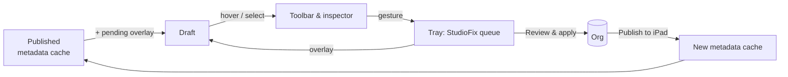

# iPad preview — Edit mode

Status: design, 2026-10-18. Branch `feat/ipad-edit-mode`.

## The problem

An admin looking at the iPad preview asks three questions about anything on screen:

1. **What is this?** Which piece of configuration put it here?
2. **Why do I see it?** Which profile, permission set, assignment or visibility rule makes it show up for this rep?
3. **How do I change it?** Move it, hide it, remove it, add something next to it, configure it.

Today the "As published" preview, the accurate one, answers none of these: nothing in it can be clicked. The "After next publish" schematic can be clicked, but it doesn't look like the app. Edit mode merges the two: the accurate picture, where you can select things and change them in place.

## Principles

- **The preview is the editor.** You change things where you see them. Setup boards stay the place for bulk and deep work; the preview links to them and doesn't duplicate them.
- **Nothing is written until you review it.** Every gesture queues a change in the existing tray. Review, apply, undo and Publish to iPad all work as they do today. Edit mode adds no new write path.
- **Honest about reach.** A Home page is shared by every profile it's assigned to. A layout applies to every record type that uses it. Each edit says who it affects before you make it.
- **Honest about capability.** If Studio can't write something, the preview still explains it and gives exact steps plus "Open in Setup". There are no dead clicks and no fake edits.
- **Calm.** No chrome until you ask for it. Hover reveals, click selects, and the toolbar shows only verbs that work on the thing you selected.

## The experience

### Entering

A segmented control above the device: **Published · Draft**. A pencil **Edit** button (`E`) sits beside it.

- **Published**: what reps have today, from the metadata cache.
- **Draft**: Published with every pending tray change laid on top. Turning Edit on switches to Draft automatically.

This replaces the "After next publish (estimate)" schematic. Draft is the estimate, drawn with the real renderer.

### Hover and select

In Edit mode every block that comes from configuration gets a hairline outline on hover, with a small name tag at its top-left corner, e.g. `Home component · Next Best Customers`. Blocks include tab pills, Home components, record header fields, layout sections, fields, related lists, ••• actions, list views and the sync badge.

Clicking selects the block: a 2pt accent ring plus a **floating toolbar** anchored above it, like Keynote or Freeform. The toolbar shows only the verbs that apply to that block:

| Verb | Shown for |
|---|---|
| ↑ ↓ / drag handle | tabs, Home components, layout fields and sections, actions |
| Hide / Show | tabs, actions (IsActive); components with a visibility rule |
| Remove | Home components, layout fields and related lists, tabs |
| ＋ Add before / after | anything ordered |
| Configure… | component props, field required/read-only, action fields |
| ⓘ | opens the docked inspector at What / Why / How |

Keyboard shortcuts: `⌫` remove, `⌥↑/⌥↓` move, `⌘Z` / `⇧⌘Z` undo/redo the last tray change, `Esc` deselect, `Tab` next block.

### Direct manipulation

- **Drag to reorder.** Blocks lift with a soft shadow and slight scale. Siblings slide out of the way with spring easing. On drop the change is queued and the moved block pulses once in the "pending" purple. Within a region only; cross-region moves are refused, with a nudge animation.
- **Insertion points.** Between ordered siblings, hovering the gap shows a thin `＋` line. Clicking it opens a **library popover** of what can go there: Home components the template supports, layout fields that exist on the object but aren't on the layout (with "not synced to the device" warnings from DB Schema), tabs not yet on the bar, quick-action types. Search at the top; items the iPad can't render (OmniStudio, unsupported LWCs) are greyed out with the reason.
- **Removed items** stay in Draft as ghosts (translucent, struck label) until you apply, so you can undo them in place.

### The inspector: What / Why / How

Docked beside the device, three short sections:

- **What**: the type and its source, as a breadcrumb: `FlexiPage "LSC Home" › main region › 3rd of 6`, or `Layout "Account-HCP Layout" › Section "Details" › field Specialty__c`, or `Admin Console › UISchema › TAB_Accounts`.
- **Why you see it**: the audience chain for the current View as profile. Tab visible via profile assignment; component shown because `$Permission.X` is granted by PSG Y; field readable via FLS on permission set Z.
- **How to change it**: the verbs above as buttons, then the reach ("Affects 3 profiles: Rep, KAM, Manager"), then, for anything Studio can't write, numbered Setup steps with **Open in Setup**.

### Leaving and committing

The tray (already in Studio) fills as you work. The preview shows a quiet counter, `4 changes · Review`. Review opens the existing ReviewDialog, which already does before/after, guards, apply in order and undo all. Changes to Admin Console records or Metadata then offer **Publish to iPad** for the affected profiles. Until publish finishes, Draft keeps a banner: *Applied, not yet on iPads*.



## What can be edited

| Surface | Store | Studio today | Edit mode |
|---|---|---|---|
| Tab bar: order, hide, add, remove | UISchema `LifeSciConfigRecord` (TabOrder, IsActive) | `setConfigField`, `setActive`, `createConfigRecord` exist | Phase 2: drag, toggle, library. Overlay pending TabOrder |
| ••• actions: order, hide, add | QuickAction / CustomAction records (SortOrder, IsActive) | same as above | Phase 2 |
| DB Schema: is this object on the device | DbSchema records | exists | Phase 2: "Not synced" chip with **Add to iPad sync** |
| Home components: order, remove, add, props | FlexiPage (Metadata API) | none | Phase 3: new fix `editFlexiPage` |
| Record page tabs and components | FlexiPage | none | Phase 3: same fix kind |
| Layout fields, sections, related lists | Layout (Metadata API) | Visit related lists only | Phase 3: generalize `visit-layout.ts` into `editLayout` |
| Record header fields | CompactLayout | none | Phase 3: `editCompactLayout` |
| List views | ListView | none | Phase 4 (filters are a larger UI) |
| Visibility rules, record type assignment, FLS | various | none | Explain + Open in Setup only (for now) |

### New fix kinds (Phase 3)

All three follow the pattern `visit-layout.ts` already uses: retrieve XML → apply a structured op → deploy.

```ts
type MetadataOp =
  | { op: "move"; path: ItemPath; toIndex: number }
  | { op: "remove"; path: ItemPath }
  | { op: "insert"; parent: ItemPath; index: number; item: unknown }
  | { op: "setProp"; path: ItemPath; name: string; value: string | null };

{ kind: "editFlexiPage"; pageName; ops: MetadataOp[]; baseHash; label }
{ kind: "editLayout";    layoutName; ops: MetadataOp[]; baseHash; label }
{ kind: "editCompactLayout"; name; ops: MetadataOp[]; baseHash; label }
```

- **Stale guard**: `baseHash` is the hash of the retrieved XML when the change was queued. Preview refuses if it has changed, matching the existing "changed since the map was loaded".
- **Undo**: the apply result snapshots the pre-deploy XML; undo redeploys it, guarded by the post-deploy hash.
- **Tray merging**: several gestures on one page combine into one fix, with ops appended. `queueChange` replaces by key and keeps the original base. One deploy per page.

## Foundation work (Phase 1): provenance

The published snapshot (`src/studio/published.ts`) currently drops the identities edit mode needs:

- Home and record page components have only `name`. Add `source: { page, region, index, identifier? }` (`componentInstance.identifier` when present, else region+index).
- Layout sections and fields have no index. Add `source: { layout, section, column, row }`.
- Tabs have `fullName` but no UISchema DeveloperName. Match `TabName` → `UISchema:<DevName>` with the live config read.
- Home ••• actions are read live but only keep `MasterLabel` and `ActionName`. Also keep `DeveloperName`.
- Each block gets an `EditTarget` = `{ itemId (map address), capability: "edit" | "explain", reach }`, built in one pure function so it's testable without a renderer.

Phase 1 delivers the hover/select layer and the What / Why / How inspector over **Published**, read-only. That already answers "how do I…" for everything, and it ships without any new write path.

## Phases

1. **Select & explain**: provenance in the snapshot; hover/select/toolbar shell; What/Why/How inspector over Published; Open in Setup. *No writes.*
2. **Draft + Admin Console edits**: Published/Draft toggle; pending overlay for TabOrder, SortOrder, IsActive, create/delete; drag reorder and hide/add for tabs and ••• actions; DB Schema "not synced" chip. Retire the schematic estimate.
3. **Metadata edits**: `editFlexiPage`, `editLayout`, `editCompactLayout` with hash guard and undo; library popover; reach warnings; Draft rendering of ops.
4. **Polish & breadth**: list views, component props sheet, ⌘Z wired to the tray, multi-select, before/after split view.

## Open questions

- **Shared pages.** Editing a FlexiPage used by several profiles changes it for all of them. Do we offer *"Make a copy just for Rep"*? That means cloning the page and reassigning it per app+profile in the CustomApplication's profile action overrides: more Metadata, more risk. Proposed: warn in Phase 3, consider copying in Phase 4.
- **Production orgs.** FlexiPage, Layout and CompactLayout deploys don't run Apex tests, but they are live on apply. Do we want an org-type guard (an extra confirm on production)?
- **iOS fidelity.** Draft draws metadata the device hasn't seen. Rules ported from lifesciences-ios must decide what Draft shows (e.g. an unsupported component added to Home is shown greyed out with "won't render on iPad").
